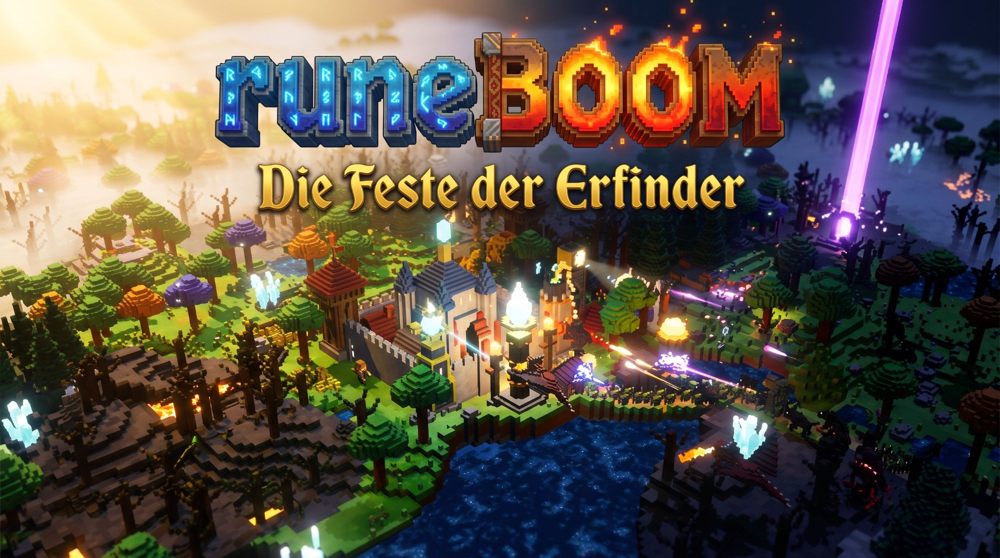

# runeBOOM · Die Feste der Erfinder

<a href="https://hoai-droid.github.io/RuneBoom/"><b>Im Browser spielen</b></a> · <a href="docs/konzeptbuch.html">Konzeptbuch</a>

**Ein episches Fantasy-Tower-Defense in Voxeln.** Am Tag baust du deine Feste aus und erfindest dich
vom Holzturm bis zum Kristall-Laser. In der Nacht kommen die Wesen der Wildnis in Wellen, am Boden
und aus der Luft.

runeBOOM ist das Schwesterspiel von [overBOOM](https://github.com/HOAI-droid/overBOOM). Es soll im
Browser, unter Windows, Mac und Linux (auch auf Steam), auf Android, iPhone und Xbox laufen, alles aus
einem gemeinsamen Code.

> **Stand: Version 0.2.** Spielbar im Browser: Weltcode, große Welt mit Nebel und Spähern, Tag und
> Nacht, Bauen, sichtbare Arbeiter, Türme, Licht, Wellen, Reparieren, Erfindungen, Klänge, Musik und Speichern. Das Konzeptbuch mit den
> Stilentwürfen liegt unter [`docs/konzeptbuch.html`](docs/konzeptbuch.html).

## Spielen

- **Im Browser:** nach dem Einrichten von GitHub Pages unter <https://hoai-droid.github.io/RuneBoom/>
  (Repository → Settings → Pages → Source: „GitHub Actions“; jeder Push auf `main` veröffentlicht neu).
- **Selbst bauen:** `npm install`, dann `npm run dev` und die angezeigte Adresse öffnen.

### Steuerung

| Eingabe | Wirkung |
|---|---|
| Ziehen (linke oder mittlere Maustaste) · Mausrad | Karte verschieben · zoomen (rechte Maustaste oder zwei Finger: drehen) |
| W A S D · Q E | verschieben · drehen |
| 1 – 8 | Gebäude wählen, Klick setzt es; Mauern durch Ziehen |
| X | Späher in den Nebel schicken (15 Holz) |
| T | Erfinderwerkstatt |
| N · Leertaste | Nacht einläuten · Pause |
| Esc · Rechtsklick | abbrechen |

Gespeichert wird automatisch zu Beginn jedes Tages im Browser.

### Neu in 0.2

- Die ganze Welt ist sofort da: Bäume und Felsen erst grob, im Blickfeld werden sie fein nachgeladen.
- Arbeiter laufen sichtbar los, fällen Bäume, brechen Felsen und schlagen Kristall ab und tragen alles heim. Gefällte Bäume werden zu Stümpfen und wachsen nach drei Tagen als Setzling, nach sechs Tagen als Baum nach.
- Bogenschützen auf den Wachtürmen, gut sichtbare Pfeile mit Leuchtspur, Feuertöpfe mit Rauch und Brandflecken.
- Lebensbalken über Wesen und Gebäuden; Gebäude rauchen, wenn sie stark beschädigt sind.
- Reparieren am Tag gegen Rohstoffe, mit Baumeistern und Fortschrittsbalken; „Alles reparieren“ in der Anzeige.
- Leuchtender Weg der Welle am Boden, besonders am Abend.
- Nebelrochen: fliegt über die Mauern und setzt Moorwichte ab.
- Klänge und Musik (Tag ruhig, Nacht episch), Einführung in den ersten Tag, Einstellungen mit Lautstärke und Grafikstufe.
- Mehr Rohstoffe zu Beginn, Holzfäller und Steinbruch stehen schon; Verschieben auch mit der mittleren Maustaste.

### Was der Prototyp schon kann

- Welt mit 1024 × 1024 Blöcken aus dem Weltcode, Kacheln laden im Hintergrund nach, fern eine grobe Übersicht.
- Bodennebel über dem Unerkundeten; Späher und neue Gebäude decken auf.
- Tag (Arbeiter sammeln Holz, Stein, Kristall) und Nacht (Wellen aus dem Riss, ab Nacht 5 auch aus einem zweiten).
- Wachturm, Feuertopf-Schleuder, Fackelmast, Leuchtfeuer, Mauern, Holzfäller, Steinbruch, Kristallmine.
- Licht in der Nacht über eine Lichtkarte: Türme treffen im Licht weiter und besser, Schattenwölfe sind nur im Licht zu sehen.
- Moorwichte, Schattenwölfe, Steintrolle und fliegende Drachlinge; Wege um Mauern herum, sonst brechen sie durch.
- Vier Erfindungen: Sprengpulver, Leuchtfeuer, Runenpfeile, Stahlguss.

## Aufbau des Codes

| Ordner | Inhalt |
|---|---|
| `packages/core` | Simulation ohne Grafik: Welt aus dem Seed, Spielwerte, Wegfeld, Spielablauf, Speichern. Tests: `npm test` |
| `packages/render` | Three.js: Voxel-Modelle, Kacheln im Hintergrund-Rechner, Nebel, Lichtkarte, Tag und Nacht, Nachbearbeitung |
| `apps/web` | Browser-Fassung: Oberfläche, Eingabe, Hauptschleife |
| `docs` | Konzeptbuch |

---

## Worum es geht

Auf einer großen, schwebenden Welt baust du eine Feste: Mauern, Türme, Häuser, Felder, Werkstätten.
Die Welt ist voller Rohstoffe, doch die guten liegen weit draußen. Wer sich ausdehnt, wird reicher,
muss in der Nacht aber mehr Fläche halten.

Das Spiel soll in wenigen Minuten verständlich sein und trotzdem lange tragen. Die erste Partie
beginnt mit einem Turm und einem Rohstoff, alles Weitere kommt Schritt für Schritt dazu. Es gibt
keinen Helden, der herumläuft: Du planst, baust, erfindest und greifst mit Fähigkeiten der Feste ein.

### Die vier Grundsätze

- **Schnell drin, lange dabei:** keine Lehrstunde vorneweg, die Tiefe wächst mit.
- **Erfinden statt Freischalten:** Fortschritt entsteht aus Erfindungen. Die Feste wächst sichtbar vom Holz zum Kristall.
- **Ausdehnen oder sicher bleiben:** Reichtum draußen gegen Sicherheit hinter den Mauern.
- **Voxel, die krachen:** Mauern verlieren Blöcke, Wesen zerfallen in Voxel, Explosionen lösen Ketten aus.

## Ein Tag in runeBOOM

| Phase | Was passiert |
|---|---|
| **Tag – ruhig** | Niemand greift an. Arbeiter holen Holz, Stein, Erz und Kristall. Du baust, forschst und schickst Späher in die Welt. Zum Abend zeigt die Vorschau, was in der Nacht kommt. |
| **Nacht – Welle** | Aus den Rissen kommen die Wesen. Türme schießen, du hilfst mit Fähigkeiten der Feste nach: Feuerregen, Mauer stärken, Notreparatur. |
| **Morgen – Erfinden** | Besiegte Wesen lassen Bausteine fallen. In der Erfinderwerkstatt entsteht daraus Neues, danach rüstest du um und baust aus. |

## Erfindungen statt Forschungsbaum

Bausteine findest du beim Sammeln, beim Erkunden und bei besiegten Wesen. Zwei oder drei davon ergeben
eine Erfindung. Ein Teil der Rezepte ist offen, der Rest muss entdeckt werden. Gefundene Rezepte
bleiben im Rezeptbuch: Das ist Wissen, keine Stärke.

| Bausteine | Erfindung | Schaltet frei |
|---|---|---|
| Feuerstein + Windrune | Sprengpulver | Feuertopf-Schleuder, Sprengfallen |
| Eisenerz + Glut | Stahlguss | Stahlmauern, Bolzen mit Durchschlag |
| Zahnrad + Dampfquelle | Uhrwerk | Repetierer, Arbeiter, die von selbst arbeiten |
| Drachenschuppe + Stahlguss | Schuppenpanzer | feuerfeste Mauern |
| Rochenhaut + Windrune | Fangnetz | holt Flieger auf den Boden |
| Blitzharz + Kristall | Kristallspule | Kristall-Laser, Schildkuppel |
| Schattenfell + Kristall + ? | geheim | wird beim Ausprobieren entdeckt |

Jeder Turm und jedes Gebäude wird einzeln umgerüstet. Deshalb steht in der Feste oft Altes neben Neuem.
Je Turm gibt es pro Zeitalter zwei Zweige, und benachbarte Türme lassen sich verschmelzen.

## Vier Zeitalter

Die Zeitalter folgen keinem Vorbild aus unserer Geschichte. Sie ergeben sich fließend aus dem, was
erfunden wurde.

| Zeitalter | Typisch |
|---|---|
| **Holz & Runen** | Pfeile, Runensteine, Palisaden |
| **Glut & Alchemie** | Feuertöpfe, Säure, Sprengpulver |
| **Uhrwerk & Dampf** | Zahnräder, Kanonen, Dampfhammer |
| **Blitz & Kristall** | Laser, Blitzspulen, Schildkuppeln |

## Licht in der Nacht

Nachts sieht man ohne Licht nur Umrisse und leuchtende Augen. Türme schießen trotzdem, aber mit weniger
Reichweite und treffen seltener. Leuchttürme geben in ihrem Lichtkreis einen Bonus auf Reichweite und
Treffsicherheit. Je höher ihre Stufe, desto besser erkennen sie Verborgenes.

| Leuchtturm | Zeitalter | Wirkung |
|---|---|---|
| Fackelmast | Holz & Runen | kleiner Lichtkreis, billig |
| Leuchtfeuer | Glut & Alchemie | großer Lichtkreis, braucht Brennstoff |
| Spiegel-Scheinwerfer | Uhrwerk & Dampf | drehender Lichtkegel, weite Reichweite |
| Kristall-Leuchtfeuer | Blitz & Kristall | macht Verborgenes sichtbar, etwa Schattenwölfe |

Licht lockt aber auch manche Wesen an. Wer viel Licht baut, zieht also auch Ärger an.

## Drei Völker

Jedes Volk erreicht das Kristall-Zeitalter auf eigenem Weg und spielt sich dadurch anders.

| Volk | Herkunft | Weg | Stark in | Schwach in |
|---|---|---|---|---|
| **Glutborn** | Bergvolk aus den Basaltschloten; Basalt, Kupfer, Glut | Glut → Schmelze → Plasma | Mauern, Flächenschaden | teure, langsame Türme |
| **Hainmar** | Waldvolk, baut mit lebendem Holz; Türme wachsen nach | Harz → Linsen → gebündeltes Sonnenlicht | Heilung, Wurzelfallen, Gift | Feuer |
| **Sturmweber** | Hochlandvolk; Marmor, Messing, Segel | Wind → Uhrwerk → Blitz | Reichweite, Kettenblitz, schnelle Arbeiter | dünne Mauern |

Auch die Leuchttürme unterscheiden sich: Glutschalen bei den Glutborn, Leuchtpilz-Bäume bei den Hainmar,
Blitzlaternen bei den Sturmwebern.

## Die Wesen der Wildnis

Sie kommen nur nachts, aus Rissen am Rand der Welt. Manche laufen, manche fliegen. Flieger schweben
über dem Boden und werfen Schatten. Mit der Zeit wachsen auch die Wesen: Später tragen sie Rüstung aus
Kristall.

| Wesen | Art | Verhalten | Antwort |
|---|---|---|---|
| **Moorwicht** | Boden | klein, viele, mit Speeren, kommt in Schwärmen | Flächenschaden, Pfeile |
| **Steintroll** | Boden | schwer und langsam, zerschlägt Mauern Block für Block | Fallen, Säure |
| **Schattenwolf** | Boden, verborgen | schnell, im Rudel; im Dunkeln nur als Augenpaar zu erahnen | Kristall-Leuchtfeuer, Engstellen |
| **Drachling** | Luft | fliegt über Mauern, sein Feuer setzt Holz in Brand | Bolzen, Blitz, feuerfeste Mauern |
| **Nebelrochen** | Luft | schwebt lautlos, trägt Wichte über die Mauer | Fangnetz, Kettenblitz |

Jede zehnte Nacht kommt ein **Rissfürst** mit großem Fund.

## Die Welt

- **Groß, aber nicht endlos:** Die Stammfeste spielt auf 1024 × 1024 Blöcken, eine Region der Weltreise misst 256 × 256.
  Man verschiebt die Karte wie in einem Strategiespiel.
- **Aus dem Weltcode:** Jede Welt entsteht aus einem Code wie `NEBELKRAKE-4127`. Gleicher Code ergibt gleiche
  Landschaft, gleiche Rohstoffe, gleiche Risse und gleiche Wellen. So lassen sich Welten teilen, ganz ohne Server.
- **Nebel über dem Unerkundeten:** Bodennebel zieht in Schwaden, mal dicht, mal dünner. Baumkronen und Bergkuppen
  ragen heraus, aber was am Boden geschieht, etwa anrückende Wesen, bleibt verborgen. Späher und Außenposten decken
  die Gegend auf, und was einmal erspäht ist, bleibt sichtbar.
- **Landschaft:** Wälder, Seen, Lavagruben, Basaltfelder, Hochland mit Schnee und über die Welt verteilte Kristallfelder.
- **Physik mit Tiefe:** Mauern nehmen sichtbaren Schaden, Lücken öffnen neue Wege. Gegner suchen ihren Weg selbst.
  Geschosse fliegen echte Bahnen, Feuer breitet sich auf Holz aus, Wasser löscht, Lava versperrt Wege.

## Zwei Spielmodi

- **Weltreise:** eine große Weltkarte aus vielen Regionen. Jede Region ist eine Partie von 5 bis 20 Minuten.
  Du wählst den Weg, reich, aber gefährlich, oder sicher, aber karg. Erfindungen und Rezeptbuch reisen mit.
  Die Reise endet beim Herrn der Wildnis oder mit dem Fall der Feste.
- **Stammfeste:** eine große Welt, in der du dich immer weiter entwickelst, durch alle Zeitalter. Viel Platz für
  Außenposten, Felder, Minen und zweite Mauerringe. Jede Nacht wird stärker. Jederzeit speichern und weitermachen,
  auch auf dem Handy. Rekord je Weltcode.

## Damit man noch eine Welle spielen will

- Die Vorschau am Abend zeigt, was die Welle fallen lässt. Oft fehlt genau ein Baustein für die nächste Erfindung.
- Die Nacht früher einläuten bringt einen Bonus, aber weniger Zeit zum Bauen.
- Neue Außenposten werden in der nächsten Nacht angegriffen. Hält es?
- Kettenreaktionen und Überschuss-Schaden werden belohnt, ein Erbe von overBOOM.

## Grafikstil

- **Voxel in mehreren Feinheiten:** Ein Block entspricht etwa einem Meter. Der Boden besteht aus ganzen Blöcken,
  Türme, Gebäude und Bäume aus halben Voxeln. Menschen sind rund 1,8 Blöcke groß und aus Achtel-Voxeln gebaut,
  die Wesen aus Viertel- bis Fünftel-Voxeln.
- **Tag und Nacht:** Der Tag liegt im warmen Licht der goldenen Stunde. Nachts leuchten im Mondlicht Fenster,
  Fackeln, Runen, Kristalle und Leuchttürme, und die angestrahlten Flächen werden zum Blickfang.
- **Nachbearbeitung** wie bei overBOOM: weiche Schatten, Leuchten, warme Lichter und kühle Schatten, Vignette,
  leichter Miniatur-Effekt am Bildrand. Keine Umrisslinien.
- **Bewegte Becken:** Wasser und Lava liegen leicht abgesenkt und sind animiert.
- **Kamera:** schräg von oben, frei drehbar und zoombar.

## Plattformen und Technik

Gerüst wie bei overBOOM: TypeScript und Three.js, die Simulation getrennt von der Grafik und mit Seed, damit
ein Weltcode überall dieselbe Welt ergibt. Für große Welten wird die Karte in Kacheln geteilt, die im
Hintergrund gebaut werden, nah fein und fern grob.

| Plattform | Umsetzung |
|---|---|
| Browser | GitHub Pages |
| Windows, Mac, Linux, Steam | Tauri |
| Android, iOS | Capacitor |
| Xbox | UWP-Hülle mit WebView2 |

## Stufenplan

- [x] Konzept und Stilentwürfe ([`docs/konzeptbuch.html`](docs/konzeptbuch.html))
- [x] Erster spielbarer Prototyp: Weltcode, Nebel, Tag-Nacht-Zyklus, Bauen, Türme, Licht, Wellen, erste Erfindungen
- [x] 0.2 Leben in der Feste: grob-fein-Welt, Arbeiter und Nachwachsen, sichtbarer Kampf, Lebensbalken, Reparieren, Klänge und Musik, Wegvorschau, Einführung, Nebelrochen
- [ ] Erfindungen und die vier Zeitalter
- [ ] Drei Völker, alle Wesen, Rissfürsten
- [ ] Weltreise und Stammfeste mit Speichern
- [ ] Apps für alle Plattformen

---

Alle Rechte vorbehalten.
